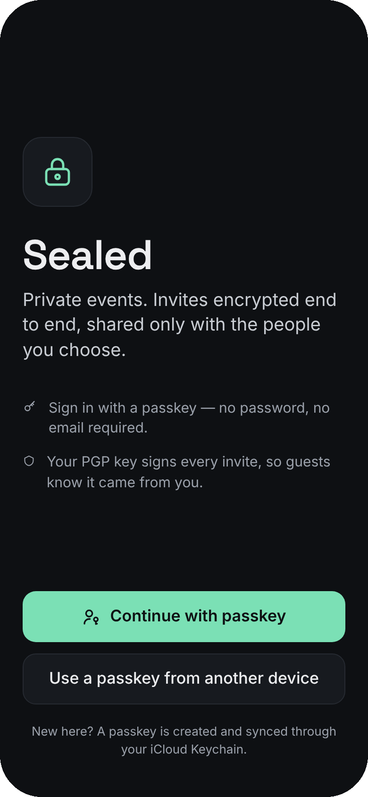
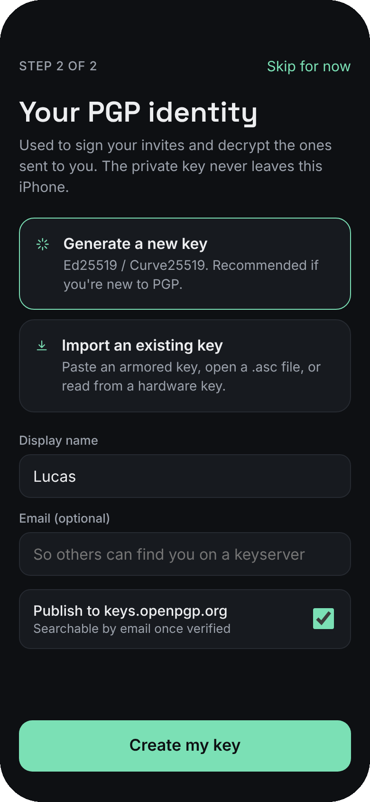
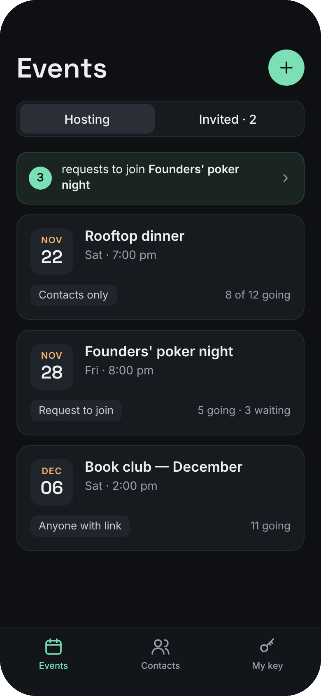
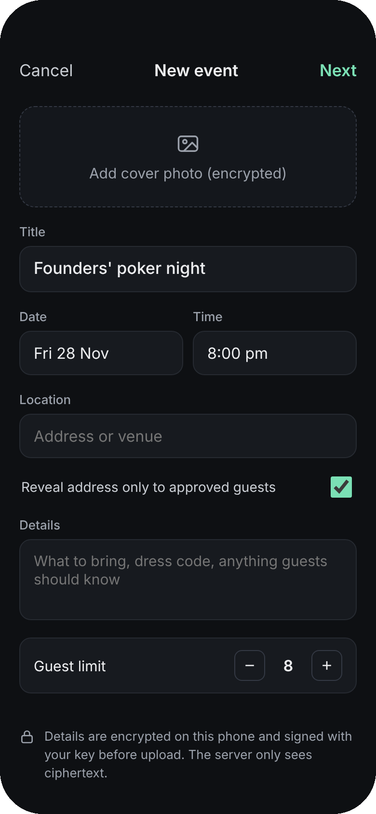
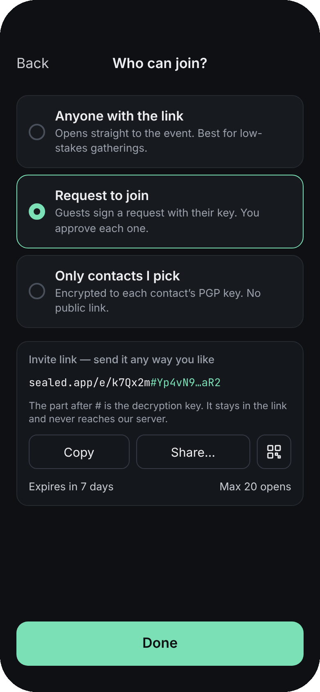
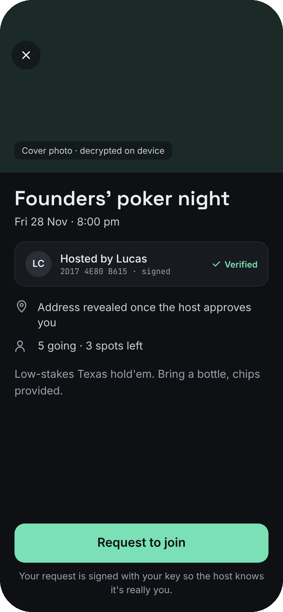
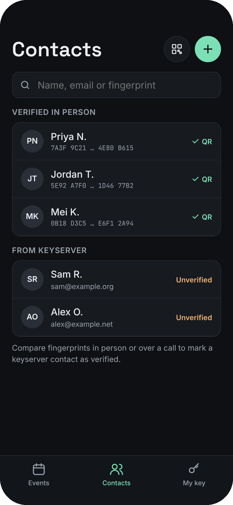
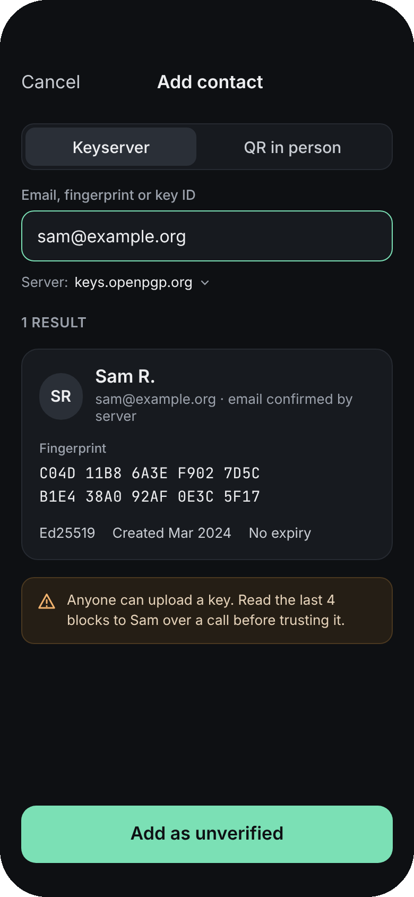
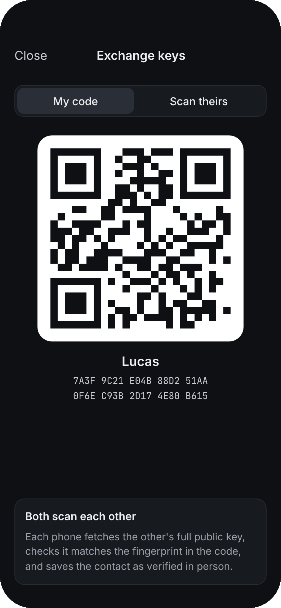

# Sealed

Private events for iOS. Hosts create an event, share it by link over any side channel (or send it encrypted to chosen contacts), and the server never sees what the event is, where it is, or who's invited.

- **Passkey sign-in** — no passwords, no email required.
- **PGP identity** — generate a Curve25519 key or import your existing one. It signs every event and join request.
- **Three ways in** — anyone with the link · request to join (host approves) · only contacts I pick.
- **Contacts** — find keys on a keyserver by email, fingerprint or key ID, or swap QR codes in person for a verified contact.

## Design

### Onboarding → hosting an event

<table>
  <tr>
    <td align="center" width="33%"><br><sub><b>1 · Passkey sign-in</b></sub></td>
    <td align="center" width="33%"><br><sub><b>2 · PGP key setup</b><br>generate or import</sub></td>
    <td align="center" width="33%"><br><sub><b>3 · Events</b><br>hosting & invited</sub></td>
  </tr>
  <tr>
    <td align="center"><br><sub><b>4 · Create event</b><br>encrypted on device</sub></td>
    <td align="center"><br><sub><b>5 · Who can join?</b><br>link · request · contacts</sub></td>
    <td align="center"><br><sub><b>6 · Guest view</b><br>opened from a link</sub></td>
  </tr>
</table>

### Contacts

<table>
  <tr>
    <td align="center" width="33%"><br><sub><b>7 · Contacts</b><br>verified vs keyserver</sub></td>
    <td align="center" width="33%"><br><sub><b>8 · Keyserver lookup</b><br>email, fingerprint or key ID</sub></td>
    <td align="center" width="33%"><br><sub><b>9 · QR exchange</b><br>verified in person</sub></td>
  </tr>
</table>

<sub>Design mocks — sample names and events are illustrative. The SwiftUI app follows these screens using native controls.</sub>

## Getting started

```sh
brew install xcodegen
xcodegen            # generates Sealed.xcodeproj from project.yml
open Sealed.xcodeproj
```

Set your team in Xcode (or `DEVELOPMENT_TEAM` in `project.yml`). Debug builds run end to end in the simulator using an in-memory backend and a development-only PGP stand-in (see below).

Core logic tests run anywhere Swift does, including Linux:

```sh
cd Packages/SealedCore && swift test
```

## Layout

```
Packages/SealedCore/     Pure-Swift core: link crypto, models, PGP protocol, keyserver client, QR card
  Sources/SealedCore/
    EventLink.swift      https://sealed.app/e/<id>#<key>
    EventCipher.swift    ChaCha20-Poly1305 envelopes bound to the event ID
    PGP.swift            PGPProvider protocol + contacts-only invites
    Keyserver.swift      VKS client for keys.openpgp.org
    ContactCard.swift    QR payload for in-person exchange
    Models.swift         Event, Contact, TrustLevel, JoinRequest
Sealed/                  SwiftUI app
  App/                   App entry, AppModel (state + flows)
  Services/              Passkeys, Keychain, backend API, PGP provider
  Views/                 Onboarding, Events, Contacts, My key
docs/                    apple-app-site-association template
```

## How the crypto fits together

**Event links.** Creating an event generates a random 96-bit event ID and a 256-bit key. The details are serialised, encrypted with ChaCha20-Poly1305 (the event ID is bound as associated data so the server can't swap ciphertexts between events), signed with the host's PGP key, and uploaded. The link is `https://sealed.app/e/<eventID>#<key>`. The fragment after `#` is never sent in HTTP requests, so the server only ever holds ciphertext it can't read.

**Request to join.** The guest signs `sealed-join-request:v1:<eventID>:<fingerprint>:<timestamp>` and sends it with their public key. The host sees who's asking and that the request wasn't forged or replayed from another event. If the host gated the address, the link-readable copy has no location; approved guests get it separately, encrypted to their key. *(Approval delivery is still a TODO — see roadmap.)*

**Contacts only.** No public link is shared. The full link (including its key) is PGP-encrypted to each chosen contact plus the host, signed, and dropped in each recipient's Sealed inbox.

**Trust levels.**

| Level | How you get it |
|---|---|
| `qrVerified` | Mutual QR scan in person. The QR carries the fingerprint; the full key is fetched and must match it. |
| `fingerprintCompared` | You compared fingerprints over a trusted channel and marked it (swipe on the contact). |
| `keyserverUnverified` | Found on a keyserver. Anyone can upload a key, so it's flagged until checked. |

Re-adding a contact never downgrades their trust.

**Keys at rest.** The armored secret key is stored in the Keychain with `kSecAttrAccessibleWhenUnlockedThisDeviceOnly` and `.userPresence` — never synced, never uploaded. Contacts, events and opened guest links (which contain event keys) are stored with complete file protection.

## PGP library

The app only talks to the `PGPProvider` protocol, so the library is swappable. **The current `DevPGPProvider` is for UI development only — it is not OpenPGP and its "encryption" is plain base64.** Release builds use `UnimplementedPGPProvider` until a real one is wired in via `PGPProviderFactory.make()`.

Options:

- **GopenPGP** (Proton, MIT) built with `gomobile bind` into an XCFramework. It's battle-tested in Proton Mail iOS and has a simple API for exactly these operations. **Recommended.**
- **Sequoia PGP** (Rust) via an FFI wrapper. Excellent, but it's LGPL/GPL-licensed and needs more glue code.
- **ObjectivePGP** works, but its licence is non-commercial unless you buy a commercial one.

## Backend

`SealedAPI` defines what the server does: WebAuthn challenge/verify, a public-key directory (so QR scans resolve without a keyserver), envelope storage, invite inboxes and join requests. `InMemorySealedAPI` stands in until a real server exists.

For passkeys and universal links, serve `docs/apple-app-site-association.json` (with your team ID) at `https://sealed.app/.well-known/apple-app-site-association`. `sealed.app` is a placeholder domain throughout — change `EventLink.host`, `PasskeyService.relyingParty` and the entitlements together.

## Roadmap

- [ ] Integrate GopenPGP behind `PGPProvider`
- [ ] HTTP `SealedAPI` + server (WebAuthn verification, envelope store, inbox)
- [ ] Host approval flow: review join requests and send the location encrypted to approved guests
- [ ] RSVP (going / maybe / can't) signed by guests
- [ ] Encrypted cover photos with the event key
- [ ] Push notifications for requests and approvals (content-free payloads)
- [ ] Link expiry and max-opens enforced server-side
- [ ] OpenPGP card / YubiKey over NFC
- [ ] Bundle Space Grotesk / JetBrains Mono to match the mocks exactly
